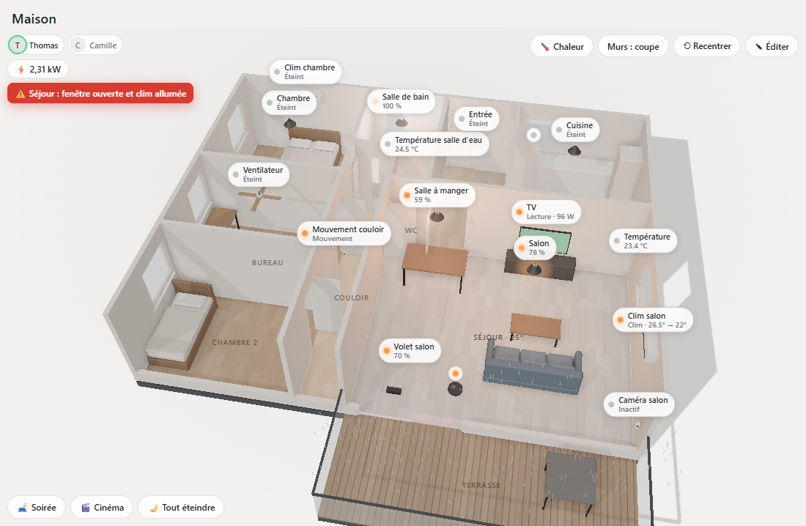

# Blueprint3D Card

[English](README.md) · **Français**

Carte Lovelace pour Home Assistant : ta maison en 3D, avec tes lampes, clims, aspirateur, volets, TV et capteurs. Tu cliques sur un appareil pour le piloter.



- La maison est **générée à partir d'un plan simple** (des pièces rectangulaires en mètres). Pas besoin de Blender.
- Les murs sont créés automatiquement, et ceux tournés vers la caméra s'abaissent pour qu'on voie l'intérieur.
- Les lampes allumées **éclairent vraiment la pièce**, avec leur couleur et leur luminosité.
- La clim souffle, le robot aspirateur se balade, les volets montent et descendent.
- Le soleil suit `sun.sun` : ombres le jour, ambiance tamisée la nuit.
- Un clic **allume ou éteint** une lampe, une prise ou un ventilateur. Un appui long, un clic droit ou un clic sur l'étiquette **ouvre la fiche de réglages**.
- Un **mode édition** permet de placer et déplacer les appareils à la souris, puis d'exporter la config YAML.

## Installation

### HACS

[](https://my.home-assistant.io/redirect/hacs_repository/?owner=ThomasLpgs&repository=blueprint3d-card&category=plugin)

1. Dans HACS, ouvre **⋮ → Dépôts personnalisés**, ajoute `https://github.com/ThomasLpgs/blueprint3d-card` en catégorie **Dashboard**. Le bouton ci-dessus fait la même chose.
2. Cherche **Blueprint3D Card**, puis clique sur **Télécharger**. HACS ajoute la ressource tout seul.
3. Recharge la page (vide le cache de l'appli sur téléphone), puis [ajoute la carte à un tableau de bord](#ajouter-la-carte-à-un-tableau-de-bord).

Les mises à jour apparaissent ensuite dans HACS.

### Manuelle

1. Télécharge `blueprint3d-card.js` depuis la [dernière release](https://github.com/ThomasLpgs/blueprint3d-card/releases/latest) (ou `npm install` puis `npm run build`, qui le produit dans `dist/`).
2. Copie `blueprint3d-card.js` dans `/config/www/` sur Home Assistant.
3. Va dans **Paramètres → Tableaux de bord → ⋮ → Ressources** et ajoute `/local/blueprint3d-card.js` en type **Module JavaScript**.
4. [Ajoute la carte à un tableau de bord](#ajouter-la-carte-à-un-tableau-de-bord).

### Ajouter la carte à un tableau de bord

La carte est plus agréable seule, en plein écran, sur son propre tableau de bord :

1. **Crée le tableau de bord** : **Paramètres → Tableaux de bord → + Ajouter un tableau de bord → Nouveau tableau de bord à partir de zéro**. Donne-lui un titre (par exemple `Maison 3D`) et une icône (par exemple `mdi:home-floor-3`), laisse **Afficher dans la barre latérale** coché, puis **Créer**.
2. Ouvre-le depuis la barre latérale et clique sur le crayon ✏️ (en haut à droite) pour le modifier.
3. **Mets-le en plein écran** : clique sur le crayon à côté du nom de la vue, choisis **Type de vue : Panneau (1 carte)**, puis **Enregistrer**.
4. **Ajoute la carte** : clique sur **+ Ajouter une carte**, puis, dans l'onglet **Par carte**, au choix :
   - cherche `blueprint3d` et choisis **Blueprint3D Card** (chercher `type: custom:…` ne trouve rien : la recherche porte sur le nom de la carte) ;
   - ou descends tout en bas de la liste, choisis **Manuel** et remplace le contenu par `type: custom:blueprint3d-card`.

   Les deux donnent la même carte. Clique sur **Enregistrer**, puis sur **Terminé**.

Sans config, la carte affiche un appartement de démo. Clique sur **✎ Éditer** dans la carte pour dessiner ton plan, puis sur **💾 Enregistrer**. Ta maison est stockée dans la config du tableau de bord (✏️ → ⋮ → **Éditeur de configuration brute**), pas dans le fichier JS : mettre à jour la carte ne la fait jamais perdre.

## Configuration

Sans pièces configurées, la carte affiche un appartement de démo et y place automatiquement tes vraies entités.

```yaml
type: custom:blueprint3d-card
title: Ma maison
height: 500          # hauteur en px (vue masonry)
wall_height: 2.5     # m
sun_entity: sun.sun  # éclairage jour/nuit
north: 0             # angle (°) entre le haut du plan et le nord
compact_labels: false
max_labels: 3        # étiquettes dépliées au premier plan (défaut : 3 sur téléphone, toutes sur grand écran)
rooms:               # rectangles en mètres, x vers la droite, y vers le bas
  - name: Salon
    x: 0
    y: 0
    w: 6
    d: 4.5
    floor: "#c9a77c"
  - name: Cuisine
    x: 6
    y: 0
    w: 3.5
    d: 4.5
openings:            # centre de l'ouverture, posé sur un mur
  - type: door
    x: 6
    y: 2.8
    width: 1.2
  - type: window
    x: 2.2
    y: 0
    width: 2.2
furniture:           # optionnel : sofa, bed, table, box
  - type: sofa
    x: 0.6
    y: 3.2
    w: 2.6
    d: 0.95
devices:
  - entity: light.salon
    position: [2, 1.8]       # [x, y] sur le plan
  - entity: climate.salon
    position: [4.2, 0.15]    # près d'un mur : s'y accroche tout seul
  - entity: vacuum.robot
    position: [1.3, 0.8]     # emplacement de la base
  - entity: cover.volet_salon
    position: [2.2, 0]       # sur une fenêtre : prend sa largeur
    height: 2.3              # optionnel
    name: Volet              # optionnel
```

- **Pièce en L** : deux rectangles côte à côte **avec le même nom**. Aucun mur n'est créé entre eux.
- **Balcon, terrasse** : ajoute `outdoor: true` pour avoir un sol sans murs.
- **Ouvertures** : `door` (passage), `glass_door` (porte-fenêtre vitrée) ou `window` (fenêtre avec allège).

Un exemple complet de maison se trouve dans `examples/maison.yaml`. Pour le voir en local : `npm run dev`, puis ouvre `/dev/index.html?plan=maison`.

### Appareils pris en charge

| Domaine | Rendu 3D | Clic | Fiche |
|---|---|---|---|
| `light` | Suspension et vraie lumière colorée | Allumer/éteindre | Luminosité, température de couleur, couleur |
| `climate` | Split mural, flux d'air bleu ou orange | Fiche | Mode, consigne, ventilation |
| `vacuum` | Robot et base, déplacement animé | Fiche | Démarrer, pause ou stop, base, localiser (selon ce que gère l'aspirateur) |
| `cover` | Volet roulant sur la fenêtre | Fiche | Ouvrir, stop, fermer, position |
| `fan` | Ventilateur de plafond qui tourne | Allumer/éteindre | Vitesse |
| `switch`, `input_boolean` | Prise avec LED | Allumer/éteindre | — |
| `media_player` | TV dont l'écran s'anime en lecture | Fiche | Lecture, piste, volume |
| `sensor`, `binary_sensor` | Petit boîtier avec étiquette | Fiche | Valeur |

Sans source de position, le déplacement du robot est **simulé** : il se balade dans sa pièce pendant le nettoyage (voir *Aspirateur* plus bas pour la vraie position).

## Au quotidien

- **Fiche de pièce** : un clic sur le sol d'une pièce l'ouvre. On y voit ses appareils, la température, l'humidité, le mouvement détecté et la consommation, avec des boutons « Tout allumer » et « Tout éteindre ». Les appareils marqués « confirmation » ne sont jamais actionnés en groupe sans accord.
- **Scènes** : des boutons en bas de la carte lancent des `scene.*` ou `script.*`. On les choisit avec **🎬 Scènes** en mode édition.
- **Portes et fenêtres vivantes** : les portes intérieures sont ouvertes, les autres fermées. Un battant suit son capteur d'ouverture, soit relié dans l'éditeur 2D, soit posé à moins de 80 cm. Une **alerte** s'affiche quand une fenêtre est ouverte alors que la clim de la pièce tourne.
- **Carte de chaleur** (bouton 🌡️) : les sols sont colorés selon la température, l'humidité ou la consommation. Une légende indique l'échelle.
- **Présence** : les personnes (`person.*`) s'affichent, en couleur si elles sont à la maison. Une pièce s'illumine doucement quand un mouvement y est détecté.
- **Énergie** : la puissance de chaque appareil est affichée (par exemple « 45 W »). Le capteur de la prise (Tapo P110, Hue…) est trouvé automatiquement dans le même appareil HA. Le compteur du logement (Linky…) se règle dans **⚙ Réglages**.
- **Aspirateur** : avec Xiaomi Cloud Map Extractor (ou toute entité exposant `vacuum_position` et `charger`), le robot suit sa vraie position et trace son trajet. La base sert de repère ; la rotation et le miroir se règlent dans sa fiche.
- **Caméras** : la fiche affiche le flux en direct avec le lecteur de Home Assistant (WebRTC ou HLS), sinon une image rafraîchie toutes les 3 s.
- **Étages** : on les déclare dans ⚙ Réglages (un nom par ligne), puis un sélecteur apparaît en haut de la carte. L'éditeur 2D montre l'étage du dessous en pointillés.
- **Météo** : pluie ou neige sur la terrasse et le balcon (sol mouillé et brillant), et soleil atténué par temps couvert, d'après `weather.*`.
- **Rendu** : parquet, carrelage et lames de terrasse générés par le code, ombres de contact, halos des lampes, tonalité naturelle, plinthes, cadres, battants et garde-corps vitrés. Les meubles ont des bords arrondis et des coussins. La qualité est réglable avec `quality: auto | high | low`.

## Éditer

Clique sur **✎ Éditer**. Deux onglets apparaissent en bas de la carte, avec les boutons 📚 Bibliothèque, 🎬 Scènes et ⚙ Réglages (titre, compteur, météo, qualité, hauteur sous plafond, nord, étages, personnes).

### 💡 Appareils (vue 3D)

1. Choisis une entité dans la liste, puis clique dans la maison pour la placer.
2. Glisse un appareil pour le déplacer. Clique dessus pour le retirer.
3. La fiche de l'appareil propose des hauteurs prédéfinies (Sol / Meuble / Mur / Plafond), un curseur de hauteur et une rotation. Sur téléphone, la caméra zoome sur l'appareil et des boutons ◀ ▶ ▼ ▲ le décalent.

### 📐 Plan (vue 2D)

| Outil | Utilisation |
|---|---|
| ↖ Sélection | Clic pour sélectionner, glisser pour déplacer, poignées pour redimensionner. Molette pour zoomer, glisser dans le vide pour se déplacer. `Suppr` efface, les flèches décalent de 5 cm (`Maj` : 50 cm). |
| ▭ Pièce | Glisse pour dessiner une pièce. Déplacer une pièce emmène ses meubles, ses appareils et ses portes. |
| Porte, porte-fenêtre, fenêtre | Clique sur un mur pour poser l'ouverture, puis glisse-la le long du mur ou ajuste sa largeur par ses poignées. |
| ▣ Meuble | Choisis le type (canapé, lit, table, bureau, chaise, armoire, meuble cuisine, plante, bloc), puis glisse pour le dessiner. Un simple clic le pose à sa taille par défaut. |
| ⧉ Calque | Charge une image de ton plan (PNG ou JPG, ou une capture d'écran du PDF). Aligne-la avec les poignées, puis décalque tes pièces par-dessus. |

Le panneau de droite permet de régler chaque élément : nom, cotes au centimètre, couleur du sol, extérieur, type, hauteur, etc. Il permet aussi de dupliquer, de faire pivoter ou de supprimer.

### 📚 Bibliothèque d'objets

Le bouton **📚 Bibliothèque** (en mode édition, dans les deux onglets) propose environ 250 objets, avec recherche, catégories et filtre par marque :

| Catégorie | Exemples |
|---|---|
| Éclairage | Hue A60, GU10, Go, Iris, Play, Lightstrip, Gradient TV, Signe, Being · Tapo L530, L510, L630, L900, L920 · Govee ampoule, ruban, Envisual TV, Lyra, Glide Hexa, lampe de table · suspension, plafonnier, spot, lampadaire… |
| Prises | Hue Smart Plug, Tapo P100 et P110, Govee, générique |
| Capteurs | Hue Motion, Secure, Dimmer · Tapo T100, T110, T310, S200B · Govee H5075 · fumée… |
| Caméras | Tapo C200, C100, générique (aperçu de l'image dans la fiche) |
| Climat & ménage | Climatiseur, aspirateur (dont Tapo RV10), ventilateur, volet |
| Multimédia | TV, Echo Dot, Nest Mini |
| Animaux | Litter-Robot 4, Petkit Pura Max, litière générique, distributeur de croquettes |
| Ponts & hubs | Hue Bridge, Tapo H100 |
| Meubles | Canapé, fauteuil, lit, table de nuit, bureau, chaise, armoire, bibliothèque, meuble TV, tapis, cuisine, frigo, lave-linge, WC, lavabo, douche, baignoire, plante… |

Pour poser un objet, choisis-le puis clique dans la maison. Sa fiche s'ouvre pour le **relier à une entité Home Assistant**. Les entités de la même marque sont proposées en premier, d'après l'intégration (hue, tplink, govee, litterrobot…).

On peut relier un objet à une entité d'un autre type, par exemple une lampe de chevet branchée sur une prise Tapo (`switch.*`). La fiche affiche alors les commandes de l'entité reliée.

Pour un appareil sensible (porte de garage, chauffe-eau…), coche **Demander confirmation avant d'agir** dans sa fiche, ou ajoute `confirm: true` dans la config. Serrures, alarmes, vannes, sirènes et chauffe-eau demandent toujours confirmation.

### Enregistrer

- **💾 Enregistrer** écrit la config directement dans le tableau de bord. Il faut un tableau de bord géré depuis l'interface (pas en YAML) et un compte admin.
- Sinon, la carte affiche le YAML à copier dans l'éditeur de la carte.

### Importer et exporter

- **⤓ Exporter la config** affiche le YAML complet (plan, meubles, appareils, calque), à copier ou à **télécharger** en fichier `.yaml`. C'est pratique pour sauvegarder ta maison ou la partager.
- **⤒ Importer** accepte du YAML ou du JSON, collé ou chargé depuis un fichier `.yaml`, `.yml` ou `.json`. Ce peut être la config de la carte seule, ou la config complète d'un tableau de bord : la carte y retrouve sa propre config.
- Le contenu importé remplace le plan et les appareils, mais rien n'est enregistré tant que tu ne cliques pas sur **💾 Enregistrer**.
- **Garde-fous de l'import** :
  - 5 Mo maximum ;
  - pas de tag YAML exécutable ;
  - seules les clés connues sont reprises ;
  - la config passe par la même validation qu'au chargement de la carte ;
  - un fichier invalide ou la config d'une autre carte est refusé avec un message clair.

## Sécurité

- **Aucune donnée ne quitte Home Assistant.** La carte ne parle qu'à ton instance, via l'objet `hass` du tableau de bord. Elle n'a ni serveur, ni compte, ni appel externe.
- **Actions limitées** : la carte n'appelle que des services sur l'entité reliée (`toggle`, `turn_on`, `set_temperature`, `open_cover`…). Les domaines sensibles (serrures, alarmes, vannes, sirènes, chauffe-eau) demandent toujours confirmation.
- **Textes échappés** : tout ce qui vient des entités (noms, attributs) ou de la config est échappé avant affichage.
- **Config vérifiée** : la config est validée au chargement (types, bornes, entity_id, couleurs, URL du calque). Une valeur invalide est ignorée avec un avertissement dans la console, sans faire planter la carte.
- **Enregistrement prudent** : il ne remplace que cette carte, et seulement si elle est trouvée exactement une fois dans le tableau de bord. Sinon, la carte propose l'export YAML.
- **Raccourcis clavier** : la saisie dans la carte ne déclenche pas les raccourcis de Home Assistant.

## Développement

```sh
npm install
npm run dev     # http://localhost:5199/dev/index.html (faux Home Assistant)
                # ?plan=maison : la maison d'exemple ; ?night : rendu de nuit ;
                # ?edit / ?edit=plan : ouvre directement le mode édition
npm run build   # dist/blueprint3d-card.js
npm run test:e2e  # ~200 contrôles de bout en bout (Edge par défaut, H3D_BROWSER=chrome sinon)
npm run check   # types + audit des dépendances + tests
```

Pour publier une version : mettre le même numéro dans `package.json` et `VERSION` (`src/blueprint3d-card.ts`), puis pousser un tag `vX.Y.Z`. Le workflow `release.yml` construit la carte et joint `blueprint3d-card.js` à la release GitHub, que HACS propose ensuite en mise à jour.

| Fichier | Rôle |
|---|---|
| `src/blueprint3d-card.ts` | L'élément Lovelace : scène, caméra, interactions, mode édition |
| `src/house.ts` | Génération des sols, murs, ouvertures et meubles, et murs coupés selon la caméra |
| `src/devices.ts` | Rendu 3D et animation de chaque type d'appareil |
| `src/panel.ts` | Fiche de contrôle |
| `src/editor.ts` | Éditeur de plan 2D (pièces, ouvertures, meubles, calque) |
| `src/catalog.ts` | Bibliothèque d'objets (modèles, formes 3D, marques) |
| `src/library.ts` | Panneau de la bibliothèque |
| `src/entities.ts` | Choix de l'entité à relier (suggestions par marque) |
| `src/validate.ts` | Validation de la config |
| `src/importer.ts` | Lecture des fichiers importés (YAML / JSON) |
| `dev/` | Page de démo avec un faux `hass` |

Inspiré de [house-control](https://github.com/0xProbabillity/house-control) (MIT).
